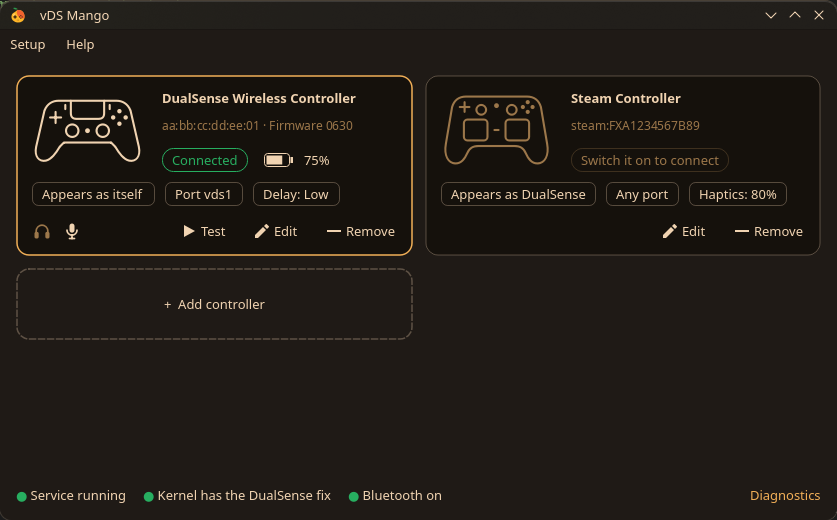
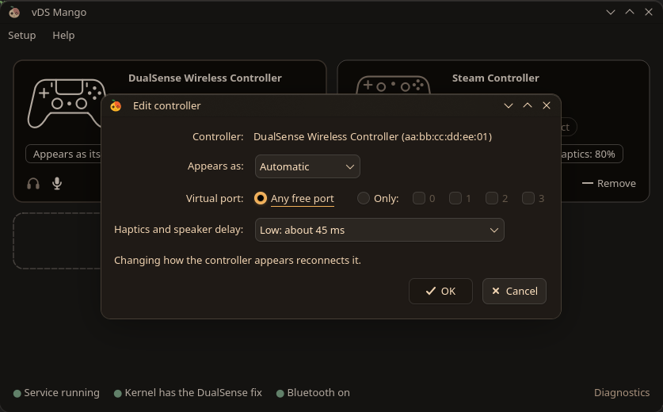

<p align="center">
  <picture>
    <source media="(prefers-color-scheme: dark)" srcset="docs/logo-dark.svg">
    
  </picture>
</p>

> [!WARNING]
>
> **CachyOS is the only supported system at the moment.** vDS Mango needs a
> kernel fix that so far only the CachyOS kernels carry. On any other kernel
> the controller is not connected. See [Requirements](#requirements).
>
> This is a beta, tested on one machine with one DualSense.

vDS Mango makes a DualSense on Bluetooth look like one on a cable. Games get
what the cable gives them: haptic feedback, adaptive triggers, the speaker,
the microphone and the headphone jack. Only firmware updates still need the
cable.

It is a Linux-only fork of [vDS](https://github.com/hurryman2212/vds) by
Jihong Min with a graphical app and no kernel module to build.

<p align="center">
  
</p>

## Features

- Haptics, adaptive triggers, speaker, microphone and headset over Bluetooth.
- A setup wizard that pairs the controller and registers it.
- Battery level, firmware version and a test buzz for each controller.
- A haptics delay you choose per controller, from about 78 ms down to about
  33 ms on the test machine.
- No kernel module. It uses `vhci_hcd`, which ships with the kernel, so there
  is nothing to build or to sign for Secure Boot.
- Other Bluetooth devices keep working.
- Experimental: a 2026 [Steam Controller](#steam-controller) as a DualSense.

GE-Proton 11-13 can play DualSense haptics over Bluetooth inside Wine on its
own. vDS Mango also covers native games and other Proton builds, and adds
the microphone.

## Requirements

- CachyOS with `linux-cachyos` 7.3.6 or newer, or `linux-cachyos-rc` 7.4-rc4
  or newer.
- `linux-cachyos-lts` 6.18, stock Arch and the mainline kernel do not have
  the fix yet. `linux-cachyos-eac` is untested.
- PipeWire. Nothing has to be configured.

The fix makes the kernel's `hid-playstation` driver ignore the controller's
Bluetooth audio reports. Without it they are read as button presses. vDS
Mango tests the driver the first time a controller connects and shows the
requirement instead of connecting it. The controller then stays an ordinary
Bluetooth gamepad.

A DualSense Edge and several controllers at once are untested.

## Install

```sh
paru -S vds-mango # or another AUR helper
```

The package starts the `vdsd` service and installs the udev and audio rules.
It conflicts with the upstream `vds` package because both ship the same
binaries.

## Set up

1. Open **vDS Mango** from the application menu.
2. Hold Create and PS until the light bar blinks rapidly, then pick the
   controller in the wizard. It pairs, trusts and registers it.
3. Press PS. Games now see a USB DualSense.

Press PS again after the computer wakes from sleep.

## The app

<p align="center">
  
</p>

- **Test** makes the controller vibrate briefly. Close a game that plays
  through the controller first.
- **Edit** sets which model games see, which virtual ports the controller may
  use, and the haptics and speaker delay. Smaller delays react sooner, and
  the lowest one can make the speaker crackle.
- The line along the bottom checks the service, the kernel fix and Bluetooth.
  A banner explains whichever one fails.
- A click or any key skips the animation when the app opens.
- **Diagnostics** holds the trace switches and a summary of your setup for
  bug reports.

## Steam Controller

A 2026 Steam Controller on its wireless Puck can be added in the same wizard.
If Steam is holding the Puck, press "Take it from Steam" first. This part is
experimental.

- It appears as a DualSense. Haptics and rumble play on its grips.
- Buttons, sticks, triggers and gyro are mapped. The two trackpads are the
  two halves of the touchpad.
- The back buttons and the "..." button are not mapped. It has no speaker,
  microphone, adaptive triggers or lights, so those are dropped.
- Edit sets the haptics strength, the rumble strength and the trackpad click.
- While one is registered, the whole Puck is hidden from Steam. Remove the
  controller in vDS Mango before you use it in Steam directly or update its
  firmware.

## Reporting issues

Report bugs on the
[CachyOS Discord](https://discord.gg/cachyos-862292009423470592). The GitHub
issue tracker is not open yet.

Paste the summary from Diagnostics > Copy system info. It contains no
Bluetooth addresses. Add your Bluetooth adapter, the game or application,
and the steps to reproduce the problem.

For a problem while playing, turn the trace switches on in Diagnostics,
reproduce it, and turn them off again. The log is `/var/log/vdsd.log`.

<details>
<summary><b>Command line</b></summary>

`vdsctl` does everything the app does. A user logged in at the computer
needs no `sudo`.

1. Pair and trust the controller. Hold Create and PS until the light bar
   blinks rapidly, then in `bluetoothctl`:

   ```text
   scan on
   pair XX:XX:XX:XX:XX:XX
   trust XX:XX:XX:XX:XX:XX
   ```

   An untrusted controller cannot reconnect on its own. To pair a controller
   that BlueZ already knows, run `remove XX:XX:XX:XX:XX:XX` first.

2. Register it, then press PS to connect:

   ```sh
   vdsctl list-targets
   vdsctl attach XX:XX:XX:XX:XX:XX
   vdsctl list
   ```

`list` shows whether each controller is connected, its virtual port (`vds0`
to `vds3`) and the last connection error.

```sh
vdsctl attach <address> --profile dse # appear as a DualSense Edge
vdsctl attach <address> --ports 0,2   # only use these virtual ports
vdsctl detach <address>               # remove the controller
vdsctl trace on --scope all           # log details, "off" to stop
```

- `attach` on a registered address updates it. Changing the profile
  reconnects the controller.
- A Steam Controller's address is `steam:<serial>`, as `list-targets` shows.
- `list` and `list-targets` print a table on a terminal. Pass `--json` or
  pipe the output to get one JSON object per line.
- `vdsctl` exits 0 on success and 1 on failure.
- `vdsd` serves root, members of the `vds` group and users logged in at the
  computer itself. Add a remote-only user (SSH) to `vds` to allow it.
- Controllers are stored in `/var/lib/vds/vdsd.db`. A database from vDS
  before 0.3.0 cannot be read: remove it and register the controllers again.

To check the virtual controller with standard tools:

```sh
lsusb -d 054c:                 # the virtual USB controller
evtest                         # buttons and axes
aplay -l                       # its sound card
```

</details>

<details>
<summary><b>How it works</b></summary>

A DualSense plays haptics through a USB sound card, so the virtual controller
needs a virtual USB port that carries audio. The kernel's USB/IP host
controller `vhci_hcd` provides one, and `vdsd` plays the USB device behind it
over a local socket. Nothing goes over the network.

```text
Game
  -> PipeWire
  -> snd-usb-audio (4 channels: speaker pair, haptics pair)
  -> vhci_hcd (USB/IP over a local socket)
  -> vdsd
  -> hidraw node of the Bluetooth controller
  -> DualSense
```

- BlueZ connects the controller as usual and `vdsd` drives it through its
  hidraw node. Nothing about Bluetooth is changed.
- While a controller is registered, a udev rule keeps its Bluetooth side away
  from other programs, so games and Steam only see the virtual USB controller.
- `vhci_hcd` refuses to let the system sleep while a device is plugged in, so
  `vdsd` unplugs the virtual controllers before sleep.
- The sound card is 48 kHz, 4 channels, S16_LE. If its sink shows only two
  channels, select the card's `pro-audio` profile with `wpctl set-profile`.

</details>

<details>
<summary><b>Build from source</b></summary>

```sh
sudo pacman -S git base-devel cmake pkgconf \
  opus systemd dbus qt6-base qt6-svg polkit

cmake . -B build -DINSTALL_SERVICE=YES
make -C build
sudo make -C build install
sudo systemctl restart vdsd.service
```

`sudo make -C build uninstall` removes it again. A source install leaves two
rules to you. The package installs both.

```sh
# Hide a registered controller's Bluetooth side from other programs.
sudo cp data/72-vds-dualsense-hide.rules /etc/udev/rules.d/
sudo udevadm control --reload-rules
sudo udevadm trigger --subsystem-match=input

# Stable names for the sound card, and never the default output.
mkdir -p ~/.config/wireplumber/wireplumber.conf.d
cp data/99-vds-dualsense-wireplumber.conf \
  ~/.config/wireplumber/wireplumber.conf.d/
systemctl --user restart pipewire pipewire-pulse wireplumber
```

To build the Arch package from the working tree:

```sh
packaging/ArchLinux/build-arch.sh --pkgrel 1 --output-dir dist/ArchLinux
```

</details>

## Credits

- [vDS](https://github.com/hurryman2212/vds) by Jihong Min is the project this
  fork is based on. You can
  [sponsor him](https://github.com/sponsors/hurryman2212).
- Microphone and headphone support were contributed to vDS by
  [@TechAntohere](https://github.com/TechAntohere).
- The DualSense output and haptics packet handling is based on
  [DS5Dongle](https://github.com/awalol/DS5Dongle) and protocol captures.

## License

[MIT](LICENSE)
